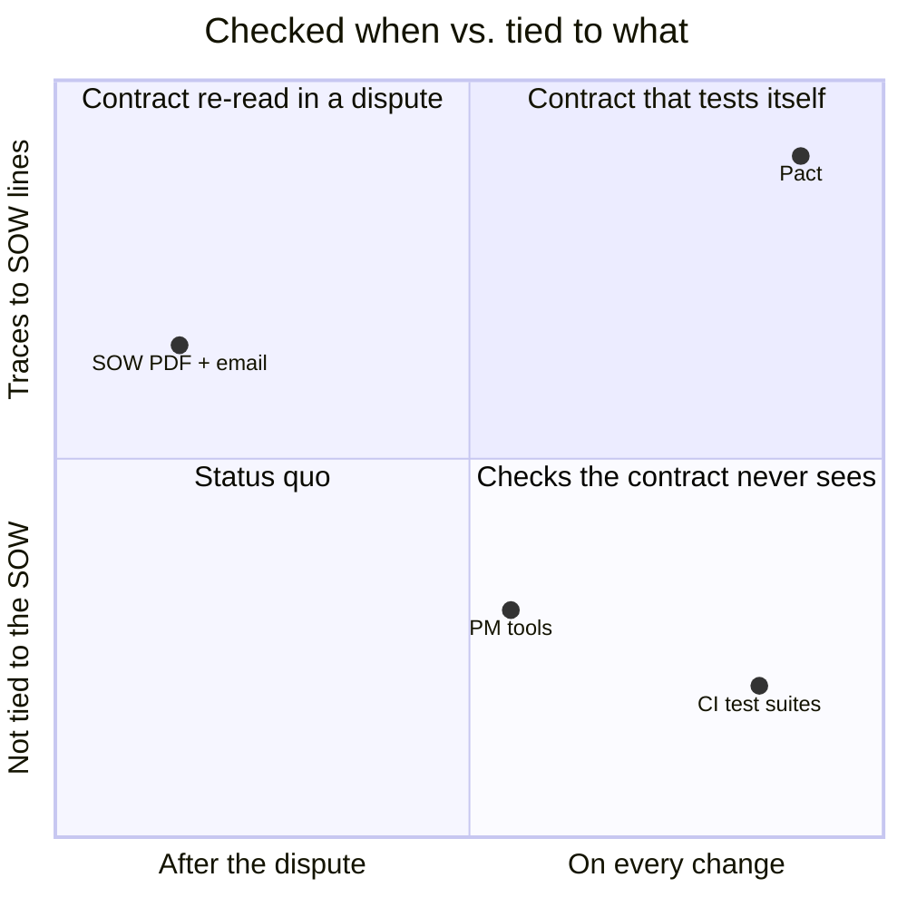
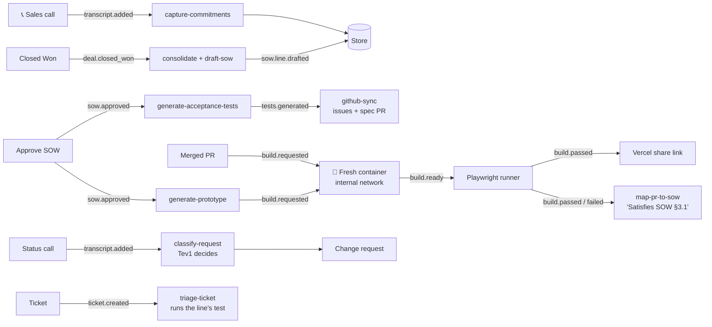
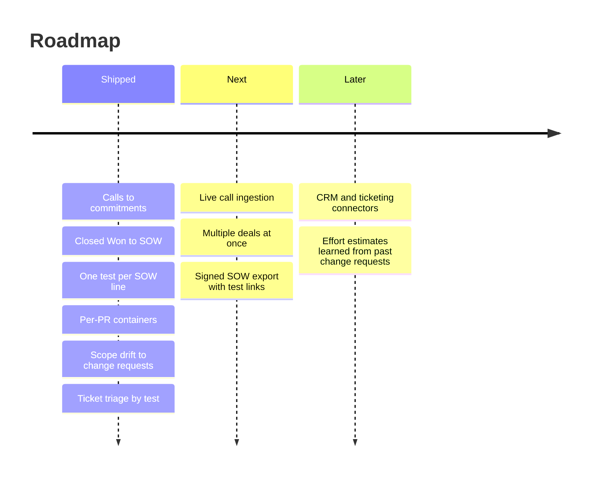

<div align="center">

# Pact

### Every promise made on a sales call becomes a test the code has to pass.

**Built in a day at a hackathon** · Delivery assurance for services firms · Runs fully local on a Dell Pro Max GB10

</div>

---

## The problem

Services projects go wrong in the gap between what sales promised and what engineering built. A requirement gets said out loud on a call ("it has to work on tablets"), half-captured in a statement of work (SOW), and never checked again until the customer finds out it's missing. Then every new request turns into an argument: is this in scope, or a paid change? Nobody can answer quickly, because the contract is a PDF and the code is a repo, and nothing connects them.

Our demo replays a public example. Per the lawsuit, Hertz alleged it paid its vendor over $32 million for a website rebuild it never got working. Part of the fight was a tablet layout that Hertz says the contract required, and that the vendor wanted extra fees to build.

<div align="center">

<table>
<tr>
<td align="center" width="25%"><h2>$32M+</h2><sub><b>Alleged spend</b><br>What Hertz alleged it paid<br><a href="demo.md">per the complaint</a></sub></td>
<td align="center" width="25%"><h2>Dec 2017</h2><sub><b>Planned go-live</b><br>The milestone that slipped<br><a href="demo.md">Complaint ¶7</a></sub></td>
<td align="center" width="25%"><h2>1 line</h2><sub><b>"Medium (Tablet) browsers"</b><br>The requirement at the heart of the dispute<br><a href="demo.md">Complaint ¶53</a></sub></td>
<td align="center" width="25%"><h2>0</h2><sub><b>Calls to cloud AI</b><br>Every model runs on the box<br><a href="#how-it-fits-together">how</a></sub></td>
</tr>
</table>

<sub>Case figures come from the public filings as cited in <a href="demo.md"><code>demo.md</code></a> §2. Check each paragraph number against the complaint PDF before publishing.</sub>

</div>

> [!NOTE]
> **Dramatized replay based on public court filings** (Hertz v. Accenture, S.D.N.Y. 1:19-cv-03508). It does not use Hertz's real data, people, calls or systems. In the replay, the delivery firm is a made-up company, Northstar Consulting. The cast, call transcripts, booking-site code and scope-drift request are all invented.

## The insight

> **A SOW line should be a test, not a sentence.**
>
> If every line in the contract has an acceptance test, three arguments disappear. "Is it done?" is a green check. "Is this new request in scope?" is a lookup against the lines. "Is this bug a warranty defect?" is whether that line's test fails on the current build. The hard part is getting from a sales call to that test without someone hand-writing it, so Pact does the whole chain: quote → commitment → SOW line → acceptance test → code → ticket.

## Why now

Local models are good enough to do this on one desk-side machine. A Dell Pro Max GB10 runs a 35B reasoning model, a 30B coding model, embeddings and a small decision model at the same time. Customer calls and contracts never leave the box, and that is the only way most services firms would let an AI read them.

## What we built

Pact is an event-driven agent. When a deal is marked Closed Won, it re-reads every sales call, pulls out each commitment with its exact quote and timestamp, and drafts a SOW where every line has a testable criterion. When the SOW is approved, Pact:

1. writes one Playwright acceptance test per SOW line,
2. builds a working prototype from the SOW and shares it by link,
3. opens a GitHub issue per line, and
4. tests every merged PR in its own fresh Docker container.

When the customer asks for something new on a status call, a local decision model checks it against the SOW and drafts a change request. When they file a bug, Pact runs that line's test against current main and decides whether it's covered under warranty or billable.

---

## How it works

<table>
<tr>
<td width="50%" valign="top">
<b>Calls → commitments</b><br>
<sub>Every sales call is parsed for promises, each kept with its exact quote and timestamp. Duplicates across calls are merged, and every source quote is kept.</sub>
</td>
<td width="50%" valign="top">
<b>Closed Won → SOW</b><br>
<sub>Dragging the deal to Closed Won streams SOW lines into the console as they're drafted. Each line has a criterion and links back to the commitments it covers.</sub>
</td>
</tr>
<tr>
<td width="50%" valign="top">
<b>SOW → tests → containers</b><br>
<sub>One Playwright spec per line, checked by code before it's saved. Every PR builds in a fresh container on an internal-only network, gets tested, and is torn down. The coverage meter shows green lines ÷ SOW lines.</sub>
</td>
<td width="50%" valign="top">
<b>Scope drift and tickets</b><br>
<sub>"Can we add a fuel-level column?" → not in the SOW → a change request with the customer's exact quote. "Booking broken on my iPad" → the tablet test fails on main → a warranty defect, routed to whoever made that line pass.</sub>
</td>
</tr>
</table>

- **The model never writes the store or the numbers.** Every model call goes through one typed client, outputs are schema-validated, and code computes every count, score and status.
- **Small decision model for scope calls.** Tev1-4B picks "covered / partly / new scope" in about a second. Only unsure answers escalate to Qwen.
- **Provably local.** On the GB10, the agent's sandbox can reach only GitHub and Vercel. The demo's "Try a cloud call" button makes a real request, which gets blocked and counted.

---

## Where we sit



### How we compare

| | SOW PDF + email | PM tools (Jira etc.) | CI test suites | **Pact** |
|---|:---:|:---:|:---:|:---:|
| Captures what sales promised, with quotes | ❌ | ❌ | ❌ | **✅** |
| Ties each requirement to a test | ❌ | ❌ | ❌ | **✅** |
| Flags scope drift as it's asked for | ❌ | ❌ | ❌ | **✅** |
| Decides warranty vs. paid change from a test | ❌ | ❌ | ❌ | **✅** |
| Mature integrations and workflows | ✅ | ✅ | ✅ | ❌ |

We lose the last row on purpose. The bet is that linking the call, the contract and the code matters more than breadth of connectors.

## Why it's hard to copy

The individual skills are reproducible. The chain isn't: a commitment is only useful if its quote, its SOW line, its test, and the PR that made it pass stay linked through every change request and every build. Pact keeps that thread intact by construction. Every event carries its IDs, every test is derived from a line, and every verdict cites the test run it came from.

## Business model

Pact is sold per active project to services firms. It sits alongside the GitHub and CRM tools a firm already uses and doesn't replace them. Because it runs on one local box, customer data never goes to a third-party AI vendor, which is often the deal-breaker for this kind of tool.

## Traction

Built in one day. In development runs on a laptop (`mac-dev` profile, qwen3.5:9b), Pact:
- generated a passing spec for all 7 lines of a real drafted SOW, and all 7 went green against the booking prototype in a fresh container that was healthy in 12 s,
- scored 85% (17/20) with the Tev1 decision model on our labeled scope cases, including all four demo cases.

---

## How it fits together



One agent process (`agent/main.ts`, Node 24) owns the event bus, the SQLite store, the skills, GitHub polling and the builder, and serves `:4000`. The dashboard (Next.js, `:3000`) only posts actions and reads `/state` and the `/stream` SSE feed. On the GB10, the agent is set up through NemoClaw to run in OpenClaw inside an OpenShell sandbox (being brought up on the box now).

| Role | GB10 | Laptop (`mac-dev`) |
|---|---|---|
| Reasoning (SOW, commitments, classification) | Qwen3.6-35B-A3B | qwen3.5:9b |
| Coding (tests, prototype fill, PR mapping) | Qwen3-Coder-30B-A3B | qwen3.5:9b |
| Embeddings | bge-m3 | bge-m3 |
| Scope decisions | Tev1-4B-experimental (vLLM) | Tev1-4B, 4-bit (Ollama) |

<details>
<summary><b>Repo map</b></summary>

| Path | What lives there |
|------|------------------|
| `core/` | Shared contract: types, store, event bus, `ctx.llm`, `ctx.decide`, cloud counter |
| `agent/` | The agent process: HTTP on `:4000`, demo actions, `/state`, SSE |
| `skills/` | One folder per skill, all registered in `skills/index.ts` |
| `prompts/` | System prompts and output schemas per skill |
| `builder/` | Per-build Docker containers, the Playwright runner image, Vercel deploy |
| `github/` | GitHub client and merged-PR polling |
| `dashboard/` | CRM board (`/deals`), Pact console (`/console`), customer portal (`/portal`) |
| `templates/booking-proto/` | The booking-flow template the prototype is built from |
| `infra/` | GB10 and laptop setup, model profiles, Tev1 serving and eval, egress policy |
| `scripts/verify/` | One check per goal; a goal is done when its script exits 0 |

</details>

## Try it

**Requirements:** Node 24, pnpm, Ollama, and Docker (Colima works on a Mac). No AI API keys, ever.

```sh
git clone https://github.com/rmotgi1227/Pact && cd Pact
bash infra/mac-dev-setup.sh       # Ollama, Colima, qwen3.5:9b, bge-m3, Tev1 4-bit, pnpm install
cp .env.example .env              # PACT_MODEL_PROFILE=mac-dev on laptops
pnpm images                       # build the pact-base and pact-runner images once
pnpm agent                        # :4000
pnpm dashboard                    # :3000
```

> [!IMPORTANT]
> Tev1 has to be called with thinking off (`reasoning_effort: "none"` on Ollama, `enable_thinking: false` on vLLM). Otherwise it spends its tokens thinking and never returns a letter. `core/src/decide.ts` already does this.

Open `localhost:3000/deals`, drop call 3, then drag the deal to Closed Won. You should see commitments appear with their quotes, then SOW lines stream into `/console`. Run any goal's check with `pnpm verify <goal>` (`r1`…`r4`, `a1`…`a5`, `s1`, `s1b`, `s2`…`s5`, `e2e`), and the local health checks with `bash infra/gb10/smoke.sh`.

For contributors: read `build-plan.md` (plan and goal loops), `demo.md` (the flow the code must support) and `CLAUDE.md` (rules for people and agents) before changing anything.

## Built with

<p align="center">


</p>

## What's next



## Team

<table>
<tr>
<td align="center">
<a href="https://github.com/rmotgi1227"><br><sub><b>Rishab</b></sub></a><br><sub>Tech lead: core, dashboard, SOW drafting, prototype</sub>
</td>
<td align="center">
<a href="https://github.com/aryanmotgi"><br><sub><b>Aryan</b></sub></a><br><sub>Transcripts, commitments, GitHub, scope drift, ticket triage</sub>
</td>
<td align="center">
<a href="https://github.com/ssmoney1"><br><sub><b>Shreyas</b></sub></a><br><sub>GB10 and models, Tev1, acceptance tests, container builds, deploy</sub>
</td>
</tr>
</table>
