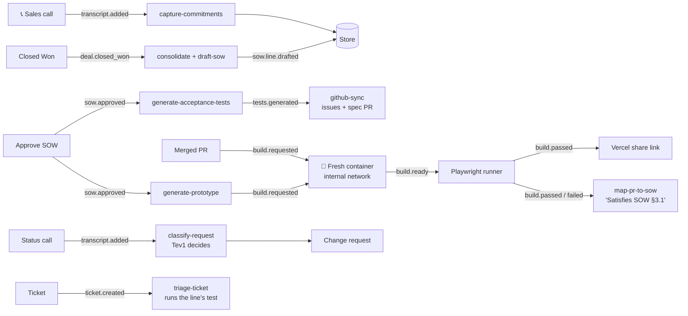

# Pact

### Every promise made on a sales call becomes a test the code has to pass.

**Built in a day at a hackathon** · Runs entirely on one Dell Pro Max GB10

---

Sales makes promises on calls. Those promises become a contract. Engineers build the product. **Pact connects all three:** it listens to the calls, writes the contract, and turns every contract line into an automatic check that runs whenever the code changes. Everyone can see, at any moment, which promises are kept.

### Key terms

| Term | Meaning |
|---|---|
| **SOW** (statement of work) | The contract: a numbered list of what will be built (§1.1, §3.1…). |
| **Commitment** | A promise from a sales call, saved with the exact words and time. |
| **Closed Won** | The deal is signed. This starts everything. |
| **Acceptance test** | An automatic check that one SOW line is done. It clicks through the site like a real user. |
| **Change request** | New work outside the contract, written up and approved before it's built. |
| **Warranty defect** | A bug in something the contract promised, fixed for free. |

---

## The problem

A requirement is said on a call (*"it has to work on tablets"*), half-written into the contract, and never checked again. The client finds out at the end. After that, every request becomes an argument: *is this included, or extra?* Nobody can answer quickly, because the contract and the code aren't connected.

Our demo replays a public example. Per the lawsuit, Hertz alleged it paid its vendor over $32 million for a website it never got working, and part of the dispute was a tablet layout Hertz says the contract required.

<table>
<tr>
<td align="center" width="25%"><h2>$32M+</h2><b>Alleged spend</b> <a href="demo.md">per the complaint</a></td>
<td align="center" width="25%"><h2>Dec 2017</h2><b>Planned launch</b> <a href="demo.md">Complaint ¶7</a></td>
<td align="center" width="25%"><h2>1 line</h2><b>"Medium (Tablet) browsers"</b> <a href="demo.md">Complaint ¶53</a></td>
<td align="center" width="25%"><h2>0</h2><b>Calls to cloud AI</b> all models run locally</td>
</tr>
</table>

> [!NOTE]
> **Dramatized replay based on public court filings** (Hertz v. Accenture, S.D.N.Y. 1:19-cv-03508). No real Hertz data, people, calls or systems. The vendor is a made-up company, Northstar Consulting, and the prototype is a generic "RentalDesk" site with no Hertz branding.

## The insight

> **Each contract line should be an automatic check, not a sentence.**
>
> Then three arguments disappear. *Is it finished?* The test is green. *Is this request included?* Check the contract lines. *Is this bug ours to fix for free?* Run that line's test: if it fails, yes.

## Why now

Local AI is now good enough for this. One GB10 runs all four models Pact needs, so calls and contracts never go to an outside AI company. That matters: in [Cisco's 2024 survey](https://www.infosecurity-magazine.com/news/banning-generative-ai-privacy-risks/), 27% of organizations had banned generative AI at least temporarily over privacy concerns.

## What we built

Pact follows a deal from the first sales call to the last support ticket. Each step starts on its own when the one before it finishes.

**1. Sales**: every promise is saved with the exact quote and when it was said, e.g. *"It has to work on tablets"* (call 3, 12:40).

**2. Delivery**: marking the deal **Closed Won** drafts the contract live, line by line, each with a testable definition of done (*"Booking works at tablet width, 768–1024px"*). One approval starts everything below.

**3. Engineering**: Pact writes one test per contract line and opens a GitHub issue for each. Every merged code change is built in a fresh, sealed environment and tested. A meter shows lines passing (*7 of 8*), and the change that fixes a line gets credit: *"Satisfies SOW §3.1"*.

**4. The client**: on day one, Pact builds a clickable prototype from the contract, tests it, and shares it as a link that works on a phone or tablet.

**5. Account management**: status calls are checked against the contract. A small, fast AI model decides *covered*, *partly covered* or *new work*. *"Can we add a fuel-level column?"* plus an engineer's *"sure"* becomes a change request, with the client's exact words, the engineer's reply and an effort estimate.

**6. Support**: a bug report runs the matching line's test on the latest code. Fails → free fix, sent to the engineer who built it. Passes → can't reproduce. No matching line → new work. *"Booking broken on my iPad"* fails the tablet test, so it's a free fix.

**7. Security**: all AI runs on the GB10, with no cloud AI and no AI API keys. Pact's code refuses to call any AI service that isn't local. The network reaches only GitHub and Vercel, and a "Try a cloud call" button proves it: the call is blocked and counted on screen.

Each box is one step of Pact's work. Each arrow is the signal that starts the next step.

---

## How we compare

| | Contract PDF + email | Project trackers | Engineering tests | **Pact** |
|---|:---:|:---:|:---:|:---:|
| Keeps sales promises word for word | ❌ | ❌ | ❌ | **✅** |
| Links each contract line to a test | ❌ | ❌ | ❌ | **✅** |
| Catches new requests as they're asked | ❌ | ❌ | ❌ | **✅** |
| Decides "free fix or paid change" from a test | ❌ | ❌ | ❌ | **✅** |
| Mature integrations | ✅ | ✅ | ✅ | ❌ |

**Why it's hard to copy:** each step is easy to rebuild. Keeping the thread from quote to contract line to test to code, through every change, is not.

## Built with

Developers: setup, architecture and the repo map are in [SETUP.md](SETUP.md).

## Team

<table>
<tr>
<td align="center">
<a href="https://github.com/rmotgi1227"> <b>Rishab</b></a> Tech lead: core system, dashboard, contract writing, prototype
</td>
<td align="center">
<a href="https://github.com/aryanmotgi"> <b>Aryan</b></a> Transcripts, promises, GitHub, new requests, bug triage
</td>
<td align="center">
<a href="https://github.com/ssmoney1"> <b>Shreyash</b></a> GB10 and AI models, decision model, tests, build environments
</td>
</tr>
</table>
