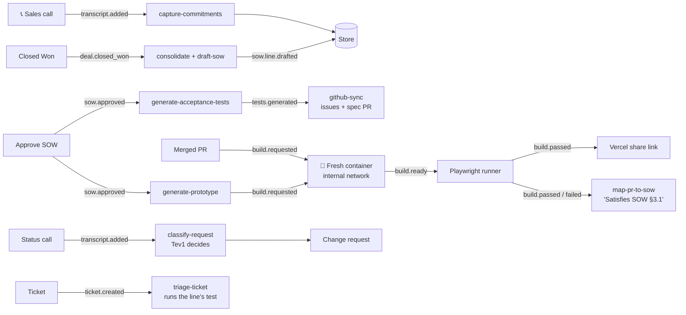

# Pact: developer setup

The project overview is in [README.md](README.md). This page is for people running or changing the code.

## How it fits together



Each box is a "skill", one small job. Each arrow is an event the previous skill publishes when it finishes.

| Job | On the GB10 | On a laptop (`mac-dev`) |
|---|---|---|
| Reading and writing (contract, promises, sorting requests) | Qwen3.6-35B-A3B | qwen3.5:9b |
| Writing code (tests, prototype, matching code changes to contract lines) | Qwen3-Coder-30B-A3B | qwen3.5:9b |
| Matching similar text (embeddings) | bge-m3 | bge-m3 |
| Quick in-or-out decisions | Tev1-4B-experimental (vLLM) | Tev1-4B, 4-bit (Ollama) |

<details>
<summary><b>Repo map</b></summary>

| Path | What lives there |
|------|------------------|
| `core/` | Shared contract: types, store, event bus, `ctx.llm`, `ctx.decide`, cloud counter |
| `agent/` | The agent process: HTTP on `:4000`, demo actions, `/state`, SSE |
| `skills/` | One folder per skill, all registered in `skills/index.ts` |
| `prompts/` | System prompts and output schemas per skill |
| `builder/` | Per-build Docker containers, the Playwright runner image, Vercel deploy |
| `github/` | GitHub client and merged-PR polling |
| `dashboard/` | CRM board (`/deals`), Pact console (`/console`), customer portal (`/portal`) |
| `templates/booking-proto/` | The booking-flow template the prototype is built from |
| `infra/` | GB10 and laptop setup, model profiles, Tev1 serving and eval, egress policy |
| `scripts/verify/` | One check per goal; a goal is done when its script exits 0 |

</details>

## Run it locally

**Requirements:** Node 24, pnpm, Ollama (runs AI models locally), and Docker (Colima works on a Mac). No AI API keys, ever.

```sh
git clone https://github.com/rmotgi1227/Pact && cd Pact
bash infra/mac-dev-setup.sh       # Ollama, Colima, qwen3.5:9b, bge-m3, Tev1 4-bit, pnpm install
cp .env.example .env              # PACT_MODEL_PROFILE=mac-dev; the agent loads .env on start
pnpm images                       # build the pact-base and pact-runner images once
pnpm agent                        # :4000
pnpm dashboard                    # :3000
```

**For the GitHub part of the demo** (needs the `gh` CLI logged in and `GITHUB_TOKEN` in `.env`):

```sh
bash scripts/setup-booking-repo.sh   # creates the private demo booking-site repo, with the tablet layout missing,
                                     # Priya's "Tablet layout" PR and the "Refactor results grid" PR that breaks it again
bash scripts/reset-booking-repo.sh   # before each rehearsal: back to the starting state with fresh PRs
```

Sharing prototype links needs `VERCEL_DEPLOY_TOKEN` (and `VERCEL_SCOPE` for a team) in `.env`. Without it, everything else still runs.

Open `localhost:3000/deals`, drop call 3, then drag the deal to Closed Won. You should see promises appear with their quotes, then contract lines stream into `/console`. `pnpm verify e2e` runs the whole demo end to end on fresh state. `pnpm verify <goal>` checks one piece (`r1`…`r4`, `a1`…`a5`, `s1`, `s1b`, `s2`…`s5`), and `bash infra/gb10/smoke.sh` checks the machine's health.

For contributors: read `build-plan.md` (plan and goal loops), `demo.md` (the flow the code must support) and `CLAUDE.md` (rules for people and agents) before changing anything.
